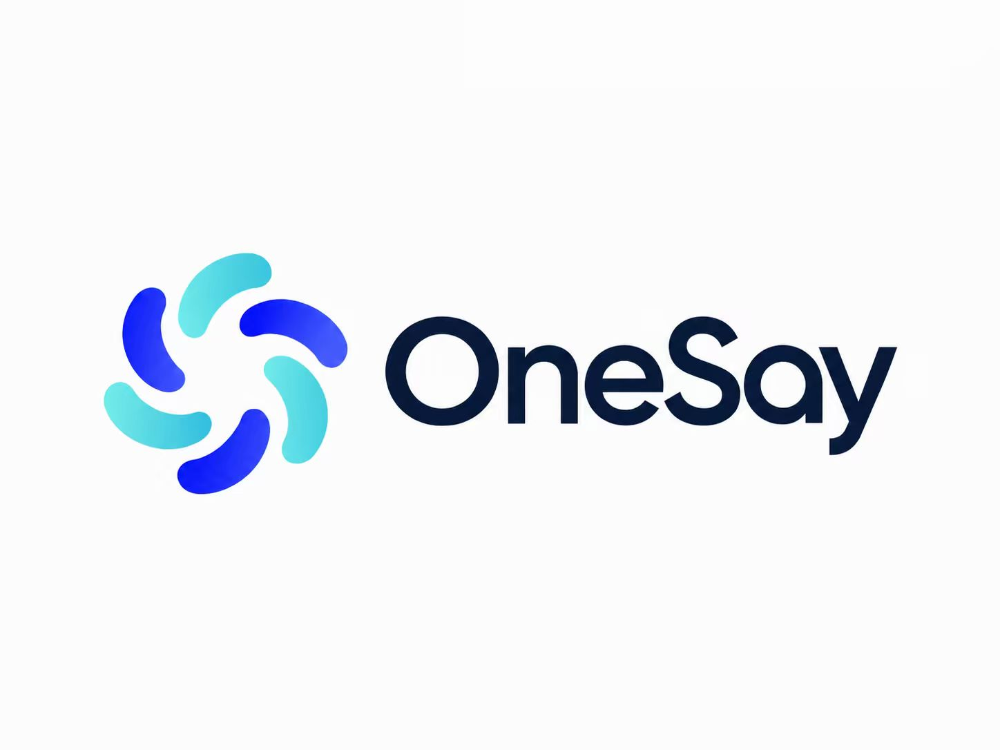
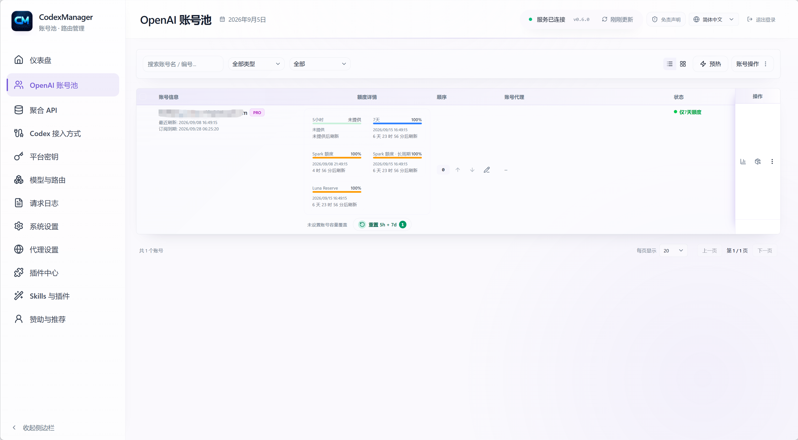
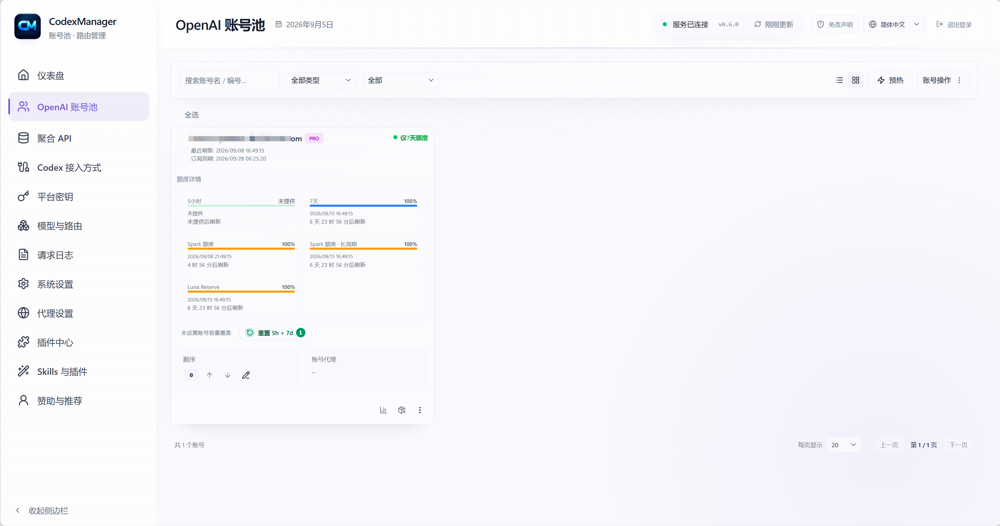
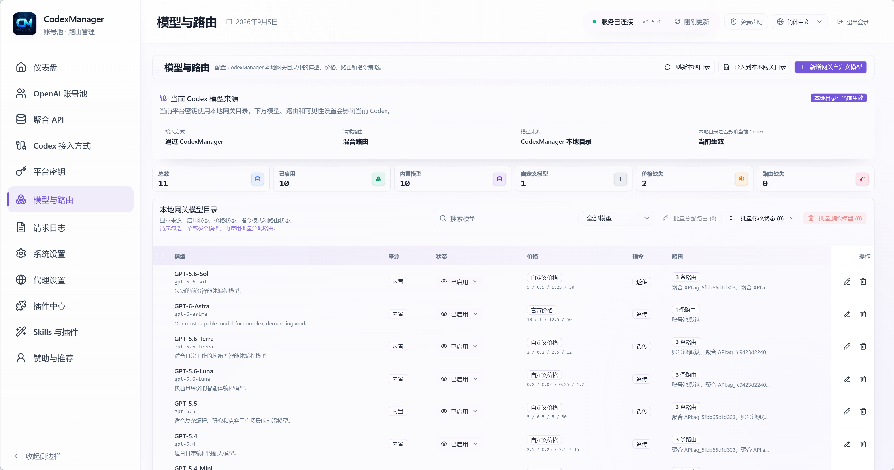
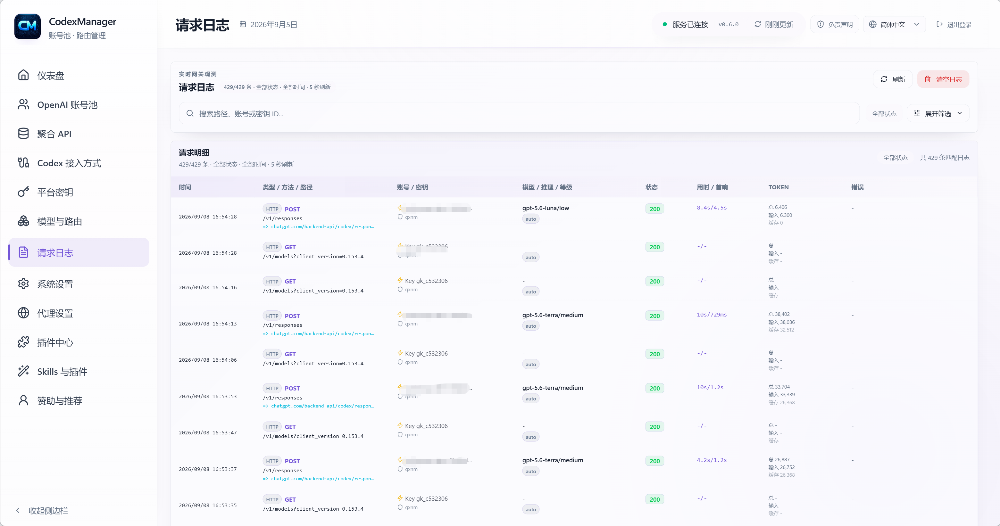
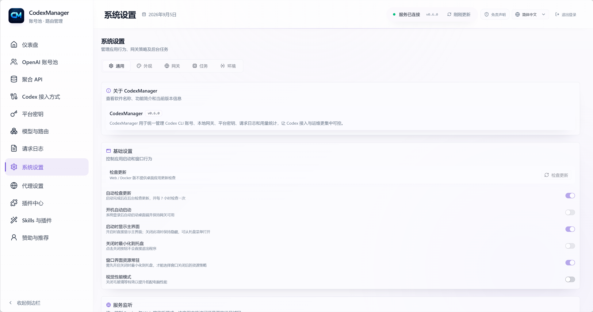

# CodexManager

<table align="center">
  <tr>
    <td align="center" valign="middle" width="44%">
      
      <br />
      <sub>
        <a href="https://qxnm.top/">Website</a> ·
        <a href="#sponsors">Sponsors</a>
      </sub>
    </td>
    <td align="center" valign="middle" width="13%">
      <sub>
        <strong>English</strong>
        <br />
        <a href="docs/zh-CN/README.md">中文</a>
        <br />
        <a href="docs/ru/README.md">Русский</a>
        <br />
        <a href="docs/ko/README.md">한국어</a>
      </sub>
    </td>
    <td align="center" valign="middle" width="23%">
      <a href="https://github.com/qxcnm/Codex-Manager">
        
      </a>
      <br />
      <a href="https://atomgit.com/qxnm/Codex-Manager">
        
      </a>
      <br />
      <a href="https://gitee.com/hongshungao/Codex-Manager">
        
      </a>
    </td>
    <td align="center" valign="middle" width="20%">
      <sub><strong>Community</strong></sub>&nbsp;
      <a href="https://linux.do/t/topic/1688401" title="LINUX DO">
        
      </a>
      &nbsp;
      <a href="https://xuanwu.openatom.org/articles/project/codex-manager/" title="Xuanwu Community">
        
      </a>
    </td>
  </tr>
</table>

**CodexManager** manages Codex CLI account pools and provides a local OpenAI-compatible gateway, with a desktop app and a browser-based Service edition.

**Interface language:** New installations default to **Auto-detect**, following the language reported by the desktop WebView or browser. Chinese, English, Russian, and Korean are supported; unsupported or unavailable language information falls back to **English**. You can choose a fixed language in the header or Settings, and saved choices are preserved.

**CodexManager has joined the [Xuanwu Community](https://xuanwu.openatom.org/articles/project/codex-manager/)**, a Rust technical community incubated and operated by the OpenAtom Foundation.

<table>
  <tr>
    <td valign="top" width="50%">
      <strong>Source Code Note</strong>
      <br />
      <sub>
        This product was built under my direction with AI: Codex (98%) and Gemini (2%). If you encounter a problem, please communicate respectfully. I do not have enough environments to validate every package and can guarantee only the Windows desktop build. For other platforms, test thoroughly before opening an Issue. Thank you to everyone who reports platform-specific problems and helps with testing.
      </sub>
    </td>
    <td valign="top" width="50%">
      <strong>Disclaimer</strong>
      <br />
      <sub>
        This project is intended solely for learning and development; users must comply with the terms of service of the relevant platforms, including OpenAI and Anthropic; the author does not provide or distribute accounts, API keys, or proxy services and is not responsible for specific uses of this software; do not use this project to circumvent rate limits or service restrictions.
      </sub>
    </td>
  </tr>
</table>

## Sponsors

This project is open to sponsorship partnerships, with pricing negotiable. Sponsors may display their brand logo, introduction, and official link in the README and in-project sponsor areas. Exact wording, placement, display period, and launch time are agreed upon by both parties. Partnerships should be relevant to developers or the AI tooling ecosystem and comply with applicable laws and regulations.

**Partnership contact:** Reach out via WeChat, Telegram, or email at `18272669457@163.com`; when adding on WeChat, please note “Sponsorship”.

Thanks to the following friends and partners for supporting CodexManager.

[](https://pateway.ai/?ch=kimnmd)

Thanks to <strong>PatewayAI</strong> for sponsoring this project!

PatewayAI focuses on high-quality official model API relay services, with full support for Claude and Codex series models, transparent billing, and enterprise-grade service.

Economy mode starts as low as 5% of standard rates. <a href="https://pateway.ai/?ch=kimnmd" rel="sponsored nofollow">Register through this link</a> to receive trial credits, join occasional promotions for free credits, and earn up to $150 in two-way referral rewards.

---

<table>
  <tr>
    <td align="center" valign="middle" width="180">
      <a href="https://sidrune.ai/register?source=github&campaign=codexmanger&promo=codexmanger"></a>
    </td>
    <td valign="top">
      <strong><a href="https://sidrune.ai/register?source=github&campaign=codexmanger&promo=codexmanger">Sidrune AI | One entry point to access and manage leading AI models worldwide</a></strong><br />
      Sidrune AI gives individual developers, technical teams, and enterprises a unified API for accessing and managing leading global AI models. Dynamic routing across multiple connections improves availability, with transparent model performance, response times, and costs. Depending on the model and route, API costs can be 40%–98% below official or reference prices.<br />
      <a href="https://sidrune.ai/register?source=github&campaign=codexmanger&promo=codexmanger">Visit and register</a> to receive $3.88 in trial credits, ready to use.
    </td>
  </tr>
  <tr>
    <td align="center" valign="middle" width="180">
      <a href="https://onesay.io"></a>
    </td>
    <td valign="top">
      <strong><a href="https://onesay.io">A great Typeless alternative: try OneSay Pro free for 3 months!</a></strong><br />
      Slow typing holding you back? Try OneSay Desktop, an AI voice assistant that combines intelligent dictation, AI translation, rewriting, and Q&amp;A. Write emails, reply to messages, and capture ideas just by speaking.<br />
      <strong>Limited-time offer: new users get 3 months of Pro free!</strong> Invite friends to register and extend your membership; more referrals mean more free time.<br />
      Start with OneSay for Typeless-level voice input productivity. Register now: <a href="https://onesay.io">https://onesay.io</a>
    </td>
  </tr>
  <tr>
    <td align="center" valign="middle" width="180">
      <a href="https://omniakey.com"></a>
    </td>
    <td valign="top">
      <strong>Hello! Glad you found us 👋</strong><br />
      We are the <strong><a href="https://omniakey.com">OmniaKey</a></strong> team, building a multimodal AI API relay platform for developers. Access text, image, video, and audio models with one API key for a wide range of AI applications.<br />
      <strong>📝 Text:</strong> GPT, Claude, Gemini, Grok, GLM, Qwen, and other leading models for chat, coding, and reasoning.<br />
      <strong>🎨 Images:</strong> GPT-image-2.5, Nanobanna 2.1, and Seedream 5.0 Pro for text-to-image, image-to-image, editing, and design.<br />
      <strong>🎬 Video:</strong> Seedance 2.5, Wan3, Kling, and MiniMaxH3 for text-to-video and image-to-video, ready to integrate.<br />
      <strong>🔊 Audio:</strong> Suno AI music generation through direct API calls for audio creation workflows.<br />
      Website: <a href="https://omniakey.com">omniakey.com</a> · Chinese site: <a href="https://omniakey.com/zh">omniakey.com/zh</a>
    </td>
  </tr>
  <tr>
    <td align="center" valign="middle" width="180">
      <a href="https://daitouai.com/"></a>
    </td>
    <td valign="top">
      <strong><a href="https://daitouai.com/">Daitou AI</a></strong> focuses on APIs for leading Chinese large language models, providing convenient access to GLM, Kimi, DeepSeek, and more for chat, coding, content creation, and automation. With prices below official rates, the platform supports quick trials for individual developers and on-demand use by independent projects and teams, helping lower model costs. Visit the <a href="https://daitouai.com/">official site</a> for available models, integration details, and current offers.
    </td>
  </tr>
  <tr>
    <td align="center" valign="middle" width="180">
      <a href="https://api.fenno.ai/s/4ADZ"></a>
    </td>
    <td valign="top">
      <strong><a href="https://api.fenno.ai/s/4ADZ">FennoAI</a></strong> provides highly stable, high-performance API relay services for enterprise R&amp;D teams and developers. It supports OpenAI and Anthropic protocols and integrates with Codex, Claude Code, OpenCode, and other mainstream AI coding tools. Its enterprise-grade infrastructure supports hundreds of billions of tokens per day, business-to-business settlement for domestic and overseas entities, and invoicing. Codex-Manager users can purchase a $50 Coding Plan allowance for only $1.99 through the <a href="https://api.fenno.ai/s/4ADZ">exclusive link</a>; earn up to 20% commission by inviting friends to subscribe, with more referrals bringing more rewards.
    </td>
  </tr>
  <tr>
    <td align="center" valign="middle" width="180">
      <a href="https://s.qiniu.com/eiaQrq"></a>
    </td>
    <td valign="top">
      <strong><a href="https://s.qiniu.com/eiaQrq">Qiniu Cloud AI</a></strong> is an enterprise large-model MaaS platform from Qiniu Cloud (02567.HK), offering one-stop access to more than 150 mainstream global models, compatibility with leading providers' protocols, and text, image, audio, video, and file processing. It serves more than 1.69 million enterprises and developers. Register through the <a href="https://s.qiniu.com/eiaQrq">exclusive link</a> for Codex-Manager benefits: enterprise users receive 12 million tokens free, while developers receive 3 million tokens free.
    </td>
  </tr>
  <tr>
    <td align="center" valign="middle" width="180">
      <a href="https://www.aixiamo.com/?utm_source=github&utm_medium=sponsor&utm_campaign=codex_manager&utm_content=logo_brand_home_v3"></a>
    </td>
    <td valign="top">
      <strong><a href="https://www.aixiamo.com/?utm_source=github&utm_medium=sponsor&utm_campaign=codex_manager&utm_content=brand_home_v3">AIXiamo official site | Legitimate ChatGPT Plus / Pro top-ups for your own account in China</a></strong><br />
      <strong>Not enough Codex allowance—Plus or Pro?</strong> Choose <a href="https://www.aixiamo.com/chatgpt-plus-domestic-recharge?utm_source=github&utm_medium=sponsor&utm_campaign=codex_manager&utm_content=plus_owner_v3">Plus</a> for everyday use; compare <a href="https://www.aixiamo.com/chatgpt-pro?utm_source=github&utm_medium=sponsor&utm_campaign=codex_manager&utm_content=pro_owner_v3">Pro 5x / 20x</a> for frequent limits or long, intensive tasks.<br />
      <strong>Sponsor guide:</strong> <a rel="sponsored nofollow" href="https://gpt-guide.aixiamo.com/knowledge">2026 guide to ChatGPT Plus / Pro top-ups and plan selection in China</a><br />
      Supports Alipay without an overseas bank card; never asks for passwords, verification codes, or recovery codes. Orders are traceable, Chinese support is available, and failed top-ups are fully refunded after verification. Operating for over three years, it has served tens of thousands of users online and offline. Claude Pro / Max, Gemini (Google AI Pro), Grok / SuperGrok, and other memberships are also available.<br />
      Enterprise purchasing is welcome. <a href="https://www.aixiamo.com/articles/aixiamo-invoice-application-notice-2026?utm_source=github&utm_medium=sponsor&utm_campaign=codex_manager&utm_content=invoice_notice_v3">Completed orders can apply for an invoice after confirming with support</a>.
    </td>
  </tr>
  <tr>
    <td align="center" valign="middle" width="180">
      <a href="https://gzxsy.vip/register?aff=eapz"></a>
    </td>
    <td valign="top">
      <strong>Xing Si Yan Gateway</strong> provides stable relay and supporting services for Claude Code, Codex, and similar model-call scenarios. It suits developers and teams requiring highly available APIs, convenient onboarding, and continuous delivery support. Visit the <a href="https://gzxsy.vip/register?aff=eapz">official site</a> for current plans.
    </td>
  </tr>
</table>

Other supporters: 呆头呆脑, [Wonderdch](https://github.com/Wonderdch), [suxinwl](https://github.com/suxinwl), [Hermit](https://github.com/HermitChen), [Suifeng023](https://github.com/Suifeng023), [HK-hub](https://github.com/HK-hub)

## ☕ Support the Project

If this project has helped you, donations are welcome!

<table>
  <tr>
    <th>Alipay</th>
    <th>WeChat Pay</th>
  </tr>
  <tr>
    <td align="center"></td>
    <td align="center"></td>
  </tr>
</table>

## Star History

<a href="https://www.star-history.com/?repos=qxcnm%2FCodex-Manager&amp;type=date&amp;legend=top-left">
 <picture>
   <source media="(prefers-color-scheme: dark)" srcset="https://api.star-history.com/chart?repos=qxcnm%2FCodex-Manager&amp;type=date&amp;legend=top-left&amp;theme=dark" />
   <source media="(prefers-color-scheme: light)" srcset="https://api.star-history.com/chart?repos=qxcnm%2FCodex-Manager&amp;type=date&amp;legend=top-left" />
   
 </picture>
</a>

## Home Navigation

| What you want to do | Go directly to |
| --- | --- |
| First launch, deployment, Docker, or macOS allowlisting | [Runtime and Deployment Guide](docs/en/report/runtime-and-deployment-guide.md) |
| Configure Codex CLI / ccswitch, `auth.json`, and `config.toml` | [Runtime and Deployment Guide](docs/en/report/runtime-and-deployment-guide.md#connect-through-ccswitch) |
| Import an account from ChatGPT `/api/auth/session` without logging in through Codex | [Chinese guide: Import ChatGPT auth session](docs/zh-CN/report/不登陆Codex使用ChatGPT-auth-session导入账号.md) |
| Configure ports, proxy, database, Web password, and environment variables | [Environment and Runtime Configuration](docs/en/report/environment-and-runtime-config.md) |
| Troubleshoot account routing, import failures, challenge interception, or request errors | [FAQ and Account Routing Rules](docs/en/report/faq-and-account-routing-rules.md) |
| Understand why background jobs skip, disable, or deactivate accounts | [Background Task Account Skip Notes](docs/en/report/background-task-account-skip-notes.md) |
| Manage models, pricing, routes, instructions policy, and Codex model catalogs | [Chinese guide: Model Catalog V2 Management and Billing](docs/zh-CN/report/模型目录V2管理与计费说明.md) |
| Minimal plugin center integration and quick onboarding | [Plugin Center Minimal Integration](docs/en/report/plugin-center-minimal-integration.md) |
| Integrate with the plugin center, view interfaces, marketplace modes, and Rhai APIs | [Plugin Center Integration and Interfaces](docs/en/report/plugin-center-integration-and-interfaces.md) |
| View every internal integration interface | [System Internal Interface Inventory](docs/en/report/system-internal-interface-inventory.md) |
| Build, package, release, or call scripts locally | [Build, Release, and Script Guide](docs/en/release/build-release-and-scripts.md) |

## Feature Overview

- Account pool management: groups, tags, ordering, notes, ban recognition, and ban filtering.
- Batch import/export: multi-file import, recursive JSON folder import on desktop, and per-account single-file export.
- Usage display: standard 5-hour + 7-day windows, 7-day-only accounts, and official additional buckets such as Code Review / Spark; refresh shows remaining percentages and reset times consistently.
- [Quota reset warmup (Chinese guide)](docs/zh-CN/额度重置自动唤醒.md): enabled by default, sends a short warmup message after an exhausted 5-hour window resets. Enable or disable it per account or in bulk to reduce the wait for the next quota refresh.
- Account authorization: `chatgpt.com` browser OAuth and Device Code login; browser OAuth also supports manually pasting the callback URL.
- Platform keys: random or custom fixed keys, disabling, deletion, model binding, reasoning tier, and service tier (follow request / Standard / Fast / Ultrafast / Flex). Keys can be bound to custom account groups and intersected with plan filters so rotation stays inside the authorized pool.
- Model management: Model Catalog V2 is the sole runtime source of truth. It supports builtin/custom models, integer input/output/cached-input rates and long-context pricing tiers, account-pool and aggregate-API routes, instructions policy, local JSON preview/commit, and applying selected models to Codex through `model_catalog_json`.
- The current catalog contains 12 built-in rows. `gpt-6.1-sol`, `gpt-6-astra`, `gpt-6-sol`, `gpt-6-luna`, the three GPT-5.6 models, `gpt-5.5`, `gpt-image-2`, and the two Image 2.5 variants make up the 11 models visible by default; only `codex-auto-review` is hidden.
- `gpt-5.4` and `gpt-5.4-mini` retired from Codex with ChatGPT sign-in on August 31, 2026, and `gpt-5.2` is also deprecated for that sign-in path; the general API model is not removed by this cleanup. Revision 9 removes their untouched built-ins, while user edits, price tiers, non-default routes, and permission/API-key associations are preserved as custom models. API-key users can also add the same slugs explicitly as custom models.
- Aggregate API: manage minimal third-party upstreams, including create, edit, balance, and connectivity tests against configured V2 routes. Administrators can manually fetch and selectively link models, or start and stop [background model synchronization](docs/en/report/model-discovery-background.md) per account or connection. Background sync is off by default and adds missing models/routes while preserving existing configuration.
- Plugin center: `/plugins/` supports built-in curated, enterprise private, and custom source marketplace modes, plus manifests, tasks, logs, and Rhai interfaces.
- Skills and plugins: `/skills/` separates Skills Installation from Codex Plugin Installation. Skills support built-in and custom GitHub repositories, repository refresh, individual Skill installation, skills.sh search and installation, ZIP/directory import, and installed-item management. Codex plugins retain the full native Marketplace installation flow; `.system` Skills remain read-only. Skills in the service user's `~/.agents/skills` are also listed as read-only; installation and removal remain confined to the managed skill directory.
- Desktop project launcher: bookmark local directories; Windows and macOS open them in the ChatGPT Codex App, while Sessions opens the `resume` selector in a new terminal with the local CodexManager profile.
- Settings: includes a system-derived settings button, per-account concurrency, upstream proxy, total and stream-idle timeouts, SSE keepalive settings and interval, and conservative high-concurrency degradation. Keepalive is enabled by default; disable it with `CODEXMANAGER_SSE_KEEPALIVE_ENABLED=0` (or `false`). Experimental upstream WebSocket is disabled by default; enable it with `CODEXMANAGER_USE_WEBSOCKET_UPSTREAM=1`.
- System internal interface inventory: all desktop/service commands, RPC methods, and built-in plugin functions.
- Local service: automatic startup with configurable port and listen address.
- Local gateway: one OpenAI-compatible endpoint for Codex CLI, Gemini CLI, Claude Code, and third-party tools; supports Gemini to `/v1/responses`, SSE, tools, MCP, skills, and request/stream timeouts.
- Image generation: injects the official Codex `image_generation` tool for `/v1/responses` by default, passes explicitly provided tools through, and provides `/v1/images/generations` and `/v1/images/edits`; the Images API compatibility main model defaults to `gpt-6-luna`, while the injected image tool remains `gpt-image-2` and the two Image 2.5 variants are available for explicit selection.

## Screenshots














## Quick Start

1. Download a package for your platform from [GitHub Releases](https://github.com/qxcnm/Codex-Manager/releases/latest), launch the desktop app, and click **Start Service**.
2. Open **Account Management** and choose browser authorization or Device Code login for `chatgpt.com`.
3. If the browser callback fails, paste the callback URL to complete parsing manually.
4. Refresh usage and verify account status.

## Default Data Directory

- The desktop app stores its SQLite database in the application data directory as `codexmanager.db`.
- Windows: `%APPDATA%\\com.codexmanager.desktop\\codexmanager.db`
- macOS: `~/Library/Application Support/com.codexmanager.desktop/codexmanager.db`
- Linux: `~/.local/share/com.codexmanager.desktop/codexmanager.db`
- Before first initialization after an upgrade, a `codexmanager.db.pre-<version>.bak` snapshot is retained in the same directory; retries for the same version do not overwrite it.
- **Desktop Diagnostics** can enable Debug mode, disable ordinary file logs, and open the log directory. Runtime logs are capped at 512 KB; request logs and token/cost statistics are unaffected.
- If the UI cannot start, use `CodexManager.exe --debug` (`CodexManager --debug` on macOS/Linux). Startup failures display the reason and write `startup-error.log` to the shown log directory.
- For database, proxy, listen-address, and other settings, see [Environment and Runtime Configuration](docs/en/report/environment-and-runtime-config.md).
- The Service edition optionally supports SeaORM MySQL/PostgreSQL backends when built with the corresponding driver. Existing SQLite data can be exported read-only and transactionally imported into an empty target database; see the [Chinese database switching and offline import guide](docs/zh-CN/report/环境变量与运行配置说明.md#service-数据库切换与离线导入). Validation with isolated local databases does not establish production acceptance; see the [Chinese migration evidence and scope](docs/zh-CN/report/Axum-Tokio-Tower-SeaORM迁移进度与会话交接.md).
- Docker defaults to `TZ=Asia/Shanghai`; Compose inherits the deployment `TZ` or falls back to `Asia/Shanghai`. Use the appropriate IANA time zone elsewhere.

## Product Views

### Desktop

- Account Management: import, export, refresh accounts and usage, with low-quota/ban filters and reset times.
- Platform Key: bind keys by model, reasoning tier, and service tier, and inspect request logs.
- Codex Connection: connect directly through an OpenAI account, directly through an aggregate API that can safely map to Responses, or through the CodexManager local gateway. Account connections write `auth.json` to switch accounts. Aggregate API and gateway connections preserve `auth.json` and update only `config.toml`; the provider field `experimental_bearer_token` holds the selected aggregate API key for direct aggregate connections or the CodexManager platform key for gateway connections. Direct aggregate-API connections bypass the local gateway and do not appear in gateway request logs.
- Model Management: desktop and Web do not write or download `~/.codex/models_cache.json`; direct accounts follow the official catalog, while the local gateway uses an independent managed catalog.
- Plugin Center: `/plugins/` provides marketplace switching, installation, enable/disable, tasks, logs, and Rhai integration.
- Skills and Plugins: `/skills/` separates Skills and Codex plugins, with repository/skills.sh install, ZIP/directory import, safe uninstall, native Marketplace flow, and read-only system Skills. The service user's `~/.agents/skills` is also listed read-only.
- Project Launcher: desktop bookmarks local folders; Windows/macOS open them in the ChatGPT Codex App, Sessions uses the local CLI, and Web/Docker do not access device directories.
- Settings: manage port, listen address, proxy, timeouts, SSE keepalive, theme, updates, and background behavior.
- The local gateway supports existing ChatGPT or API key authentication (`auth_mode = "chatgpt"` or `"apikey"`) without requiring a particular sign-in method. Gateway setup updates only `config.toml`, preserves any existing `auth.json` byte for byte, and does not create an auth file or require ChatGPT login tokens. The `cm` provider always uses `name = "cm"` and `requires_openai_auth = true`, with the platform key in `experimental_bearer_token`.

### Service Edition

- `codexmanager-service`: local OpenAI-compatible gateway.
- `codexmanager-web`: browser management page plus `/api/runtime` and `/api/rpc` proxies.
- `codexmanager-start`: starts service + web together.

## Common Documentation

- Version history: [CHANGELOG.md](docs/en/CHANGELOG.md)
- Contribution guidelines: [CONTRIBUTING.md](docs/en/CONTRIBUTING.md)
- Architecture: [ARCHITECTURE.md](docs/en/ARCHITECTURE.md)
- Testing baseline: [TESTING.md](docs/en/TESTING.md)
- Security: [SECURITY.md](docs/en/SECURITY.md)
- Model Catalog V2: [Chinese guide](docs/zh-CN/report/模型目录V2管理与计费说明.md)
- Documentation index: [Chinese documentation index](docs/zh-CN/README.md#文档首页)

## Topic Pages

| Page | Contents |
| --- | --- |
| [Runtime and Deployment Guide](docs/en/report/runtime-and-deployment-guide.md) | First launch, Docker, Service edition, and macOS allowlisting |
| [Environment and Runtime Configuration](docs/en/report/environment-and-runtime-config.md) | Application settings, proxy, listen address, database, and Web security |
| [FAQ and Account Routing Rules](docs/en/report/faq-and-account-routing-rules.md) | Account routing, challenge interception, import/export, and common errors |
| [Chinese guide: Import ChatGPT auth session](docs/zh-CN/report/不登陆Codex使用ChatGPT-auth-session导入账号.md) | Copy ChatGPT session JSON and batch-import it into the account pool |
| [Background Task Account Skip Notes](docs/en/report/background-task-account-skip-notes.md) | Background filtering, disabled accounts, and workspace deactivation |
| [Minimal Troubleshooting Guide](docs/en/report/minimal-troubleshooting-guide.md) | Service startup, request forwarding, and model refresh failures |
| [Plugin Center Integration and Interfaces](docs/en/report/plugin-center-integration-and-interfaces.md) | Routes, marketplace modes, Tauri/RPC interfaces, manifest fields, and Rhai functions |
| [Build, Release, and Script Guide](docs/en/release/build-release-and-scripts.md) | Local builds, Tauri packaging, workflows, and script parameters |
| [Release and Artifacts](docs/en/release/release-and-artifacts.md) | Platform artifacts, naming, and pre-release behavior |
| [Script and Release Responsibility Matrix](docs/en/report/script-and-release-responsibility-matrix.md) | Script responsibilities and usage scenarios |
| [Gateway vs Codex Headers and Params](docs/en/report/gateway-vs-codex-headers-and-params.md) | Gateway forwarding compared with Codex headers and parameters |
| [System Internal Interface Inventory](docs/en/report/system-internal-interface-inventory.md) | Desktop, service, and plugin-center interfaces |
| [CHANGELOG.md](docs/en/CHANGELOG.md) | Releases, unreleased changes, and full history |

## Directory Structure

```text
.
├─ apps/                # Frontend and Tauri desktop app
│  ├─ src/
│  ├─ src-tauri/
│  └─ out/
├─ crates/              # Rust core/service
│  ├─ core
│  ├─ service
│  ├─ start              # Starts service + web
│  └─ web                # Service Web UI and /api/rpc proxy
├─ docs/                # Official documentation
├─ scripts/             # Build and release scripts
└─ README.md
```

## Acknowledgements and Reference Projects

- Codex (OpenAI): referenced for request flows, login semantics, and upstream-compatible source structure <https://github.com/openai/codex>
- CLIProxyAPI (CPA): referenced for Responses request conversion and tool-call conventions <https://github.com/router-for-me/CLIProxyAPI>

## Contact

- WeChat public account: 七线牛马
- WeChat: add `ProsperGao` to join the group and state your purpose
- Telegram group: [CodexManager TG group](https://t.me/+OdpFa9GvjxhjMDhl)
