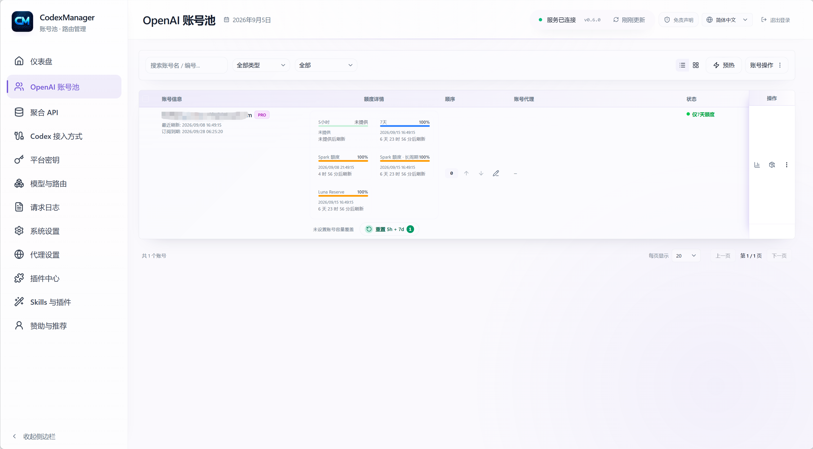
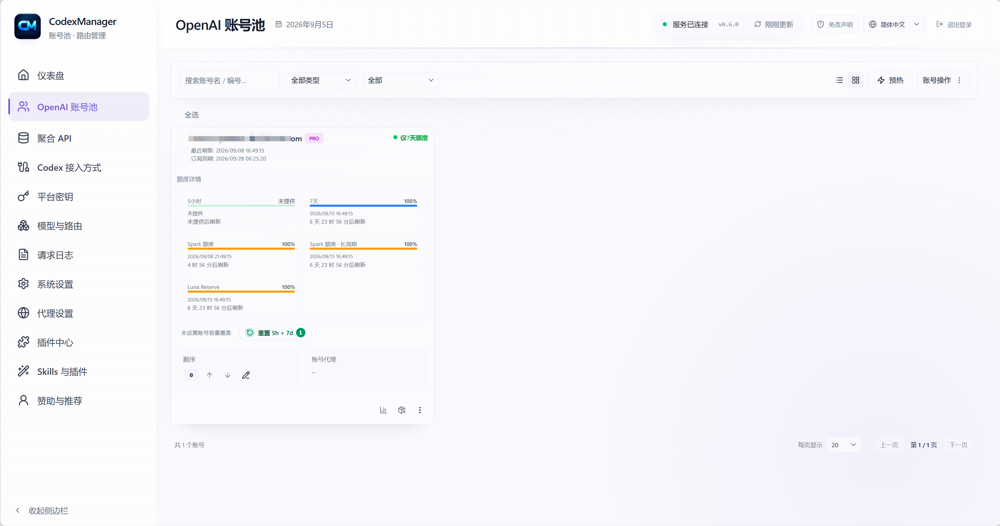
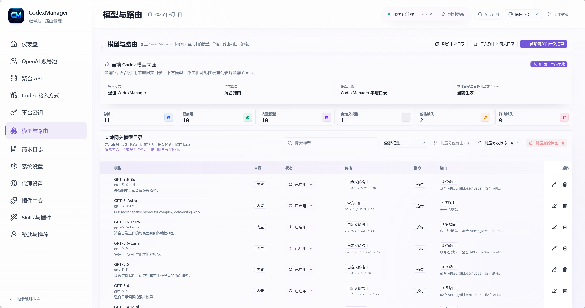
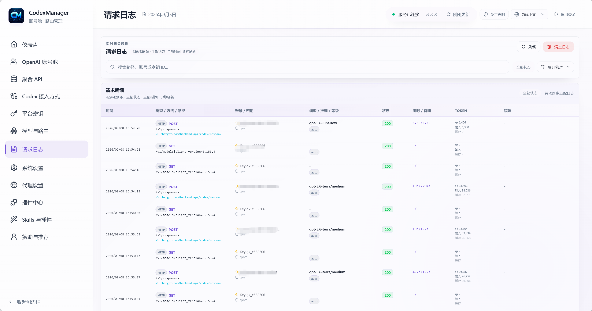
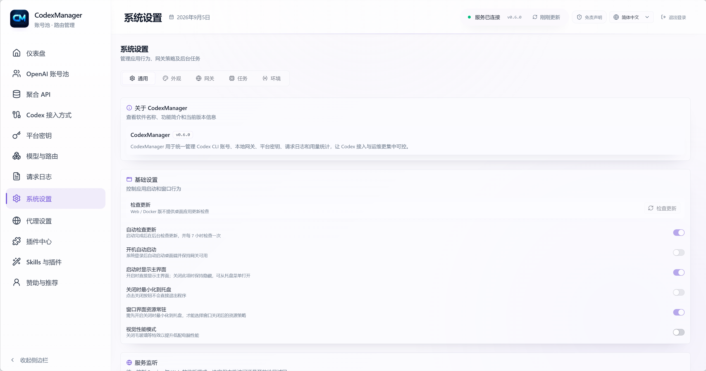

# CodexManager

<table align="center">
  <tr>
    <td align="center" valign="middle" width="44%">
      
      <br />
      <sub>
        <a href="https://qxnm.top/">官网</a> ·
        <a href="#赞助商">赞助商</a>
      </sub>
    </td>
    <td align="center" valign="middle" width="13%">
      <sub>
        <a href="../../README.md">English</a>
        <br />
        <strong>中文</strong>
        <br />
        <a href="../ru/README.md">Русский</a>
        <br />
        <a href="../ko/README.md">한국어</a>
      </sub>
    </td>
    <td align="center" valign="middle" width="23%">
      <a href="https://github.com/qxcnm/Codex-Manager">
        
      </a>
      <br />
      <a href="https://atomgit.com/qxnm/Codex-Manager">
        
      </a>
      <br />
      <a href="https://gitee.com/hongshungao/Codex-Manager">
        
      </a>
    </td>
    <td align="center" valign="middle" width="20%">
      <sub><strong>认可社区</strong></sub>&nbsp;
      <a href="https://linux.do/t/topic/1688401" title="LINUX DO">
        
      </a>
      &nbsp;
      <a href="https://xuanwu.openatom.org/articles/project/codex-manager/" title="旋武社区">
        
      </a>
    </td>
  </tr>
</table>

**CodexManager** 是 Codex CLI 账号池管理工具，提供本地 OpenAI 兼容网关，支持桌面端与浏览器访问的 Service 版。

**CodexManager 已加入 [旋武社区](https://xuanwu.openatom.org/articles/project/codex-manager/)**，这是由开放原子开源基金会孵化运营的 Rust 技术社区。

<table>
  <tr>
    <td valign="top" width="50%">
      <strong>源码说明</strong>
      <br />
      <sub>
        本产品完全由本人指挥+AI打造 Codex（98%） Gemini (2%) 如果在使用过程中产生问题请友好交流，因为开源只是觉得有人能用的上，基本功能也没什么问题，不喜勿喷。其次是本人没有足够的环境来验证每个包都有没有问题，本人也要上班(我只是个穷逼买不起mac之类的)，本人只保证win的桌面端的可用性，如果其他端有问题，请在充分测试后提交 Issues，有时间我自会处理。最后感谢各位使用者反馈的各个平台问题和参与的部分测试。
      </sub>
    </td>
    <td valign="top" width="50%">
      <strong>免责声明</strong>
      <br />
      <sub>
        本项目仅用于学习与开发目的；使用者必须遵守相关平台的服务条款（例如 OpenAI、Anthropic）；作者不提供或分发任何账号、API Key 或代理服务，也不对本软件的具体使用方式负责；请勿使用本项目绕过速率限制或服务限制。
      </sub>
    </td>
  </tr>
</table>

## 赞助商

本项目现开放赞助合作。赞助方可在 README 及项目内的赞助展示区域展示品牌 Logo、简介及官方链接；具体文案、展示位置、展示周期与上线时间由双方协商确认。为保持项目调性与用户体验，合作内容需与开发者或 AI 工具生态相关，并符合相关法律法规。

**合作洽谈：** 可通过微信、Telegram 或邮箱 `18272669457@163.com` 联系，添加好友时请备注“赞助合作”。

感谢以下朋友与伙伴对 CodexManager 的支持。

[](https://pateway.ai/?ch=kimnmd)

感谢 <strong>PatewayAI</strong> 对本项目的赞助！

PatewayAI 专注于官方高质量模型 API 中继，完整支持 Claude、Codex 系列，并提供透明计费与企业级服务。

经济模式低至 0.5 折！通过<a href="https://pateway.ai/?ch=kimnmd" rel="sponsored nofollow">此链接</a>注册可获试用额度，还可参与不定时活动领取免费额度，双向推荐奖励最高达 150 美元。

---

<table>
  <tr>
    <td align="center" valign="middle" width="180">
      <a href="mailto:18272669457@163.com?subject=CodexManager%20sponsorship%20-%20slot%201"></a>
    </td>
    <td valign="top">
      <strong>赞助位 1 · 招募中</strong><br />
      展示渠道：软件内赞助页、GitHub、Gitee、AtomGit、微信群公告、Telegram（TG）群等。<br />
      支持品牌 Logo、产品介绍与官方链接展示，具体展示安排欢迎联系洽谈。<br />
      <a href="mailto:18272669457@163.com?subject=CodexManager%20sponsorship%20-%20slot%201">洽谈此赞助位</a> · 18272669457@163.com
    </td>
  </tr>
  <tr>
    <td align="center" valign="middle" width="180">
      <a href="mailto:18272669457@163.com?subject=CodexManager%20sponsorship%20-%20slot%202"></a>
    </td>
    <td valign="top">
      <strong>赞助位 2 · 招募中</strong><br />
      展示渠道：软件内赞助页、GitHub、Gitee、AtomGit、微信群公告、Telegram（TG）群等。<br />
      支持品牌 Logo、产品介绍与官方链接展示，具体展示安排欢迎联系洽谈。<br />
      <a href="mailto:18272669457@163.com?subject=CodexManager%20sponsorship%20-%20slot%202">洽谈此赞助位</a> · 18272669457@163.com
    </td>
  </tr>
  <tr>
    <td align="center" valign="middle" width="180">
      <a href="mailto:18272669457@163.com?subject=CodexManager%20sponsorship%20-%20slot%203"></a>
    </td>
    <td valign="top">
      <strong>赞助位 3 · 招募中</strong><br />
      展示渠道：软件内赞助页、GitHub、Gitee、AtomGit、微信群公告、Telegram（TG）群等。<br />
      支持品牌 Logo、产品介绍与官方链接展示，具体展示安排欢迎联系洽谈。<br />
      <a href="mailto:18272669457@163.com?subject=CodexManager%20sponsorship%20-%20slot%203">洽谈此赞助位</a> · 18272669457@163.com
    </td>
  </tr>
  <tr>
    <td align="center" valign="middle" width="180">
      <a href="mailto:18272669457@163.com?subject=CodexManager%20sponsorship%20-%20slot%204"></a>
    </td>
    <td valign="top">
      <strong>赞助位 4 · 招募中</strong><br />
      展示渠道：软件内赞助页、GitHub、Gitee、AtomGit、微信群公告、Telegram（TG）群等。<br />
      支持品牌 Logo、产品介绍与官方链接展示，具体展示安排欢迎联系洽谈。<br />
      <a href="mailto:18272669457@163.com?subject=CodexManager%20sponsorship%20-%20slot%204">洽谈此赞助位</a> · 18272669457@163.com
    </td>
  </tr>
  <tr>
    <td align="center" valign="middle" width="180">
      <a href="mailto:18272669457@163.com?subject=CodexManager%20sponsorship%20-%20slot%205"></a>
    </td>
    <td valign="top">
      <strong>赞助位 5 · 招募中</strong><br />
      展示渠道：软件内赞助页、GitHub、Gitee、AtomGit、微信群公告、Telegram（TG）群等。<br />
      支持品牌 Logo、产品介绍与官方链接展示，具体展示安排欢迎联系洽谈。<br />
      <a href="mailto:18272669457@163.com?subject=CodexManager%20sponsorship%20-%20slot%205">洽谈此赞助位</a> · 18272669457@163.com
    </td>
  </tr>
  <tr>
    <td align="center" valign="middle" width="180">
      <a href="mailto:18272669457@163.com?subject=CodexManager%20sponsorship%20-%20slot%206"></a>
    </td>
    <td valign="top">
      <strong>赞助位 6 · 招募中</strong><br />
      展示渠道：软件内赞助页、GitHub、Gitee、AtomGit、微信群公告、Telegram（TG）群等。<br />
      支持品牌 Logo、产品介绍与官方链接展示，具体展示安排欢迎联系洽谈。<br />
      <a href="mailto:18272669457@163.com?subject=CodexManager%20sponsorship%20-%20slot%206">洽谈此赞助位</a> · 18272669457@163.com
    </td>
  </tr>
  <tr>
    <td align="center" valign="middle" width="180">
      <a href="https://daitouai.com/">
        
      </a>
    </td>
    <td valign="top">
      <strong><a href="https://daitouai.com/">呆头 AI</a></strong> 专注于国内主流大模型 API 服务，提供 GLM、Kimi、DeepSeek 等模型的便捷接入，适用于对话问答、代码生成、内容创作和自动化开发等常见场景。平台主打比官方更实惠的价格，支持个人开发者快速试用，也适合独立项目与团队按需调用，帮助降低国内大模型的使用成本。欢迎通过<a href="https://daitouai.com/">官网</a>了解可用模型、接入方式与最新优惠。
    </td>
  </tr>
  <tr>
    <td align="center" valign="middle" width="180">
      <a href="https://www.aixiamo.com/?utm_source=github&utm_medium=sponsor&utm_campaign=codex_manager&utm_content=logo_brand_home_v3">
        
      </a>
    </td>
    <td valign="top">
      <strong><a href="https://www.aixiamo.com/?utm_source=github&utm_medium=sponsor&utm_campaign=codex_manager&utm_content=brand_home_v3">AIXiamo 官网｜国内 ChatGPT Plus / Pro 本人账号正规充值</a></strong><br />
      <strong>Codex 额度不够，Plus 还是 Pro？</strong> 日常使用和普通 Codex 选 <a href="https://www.aixiamo.com/chatgpt-plus-domestic-recharge?utm_source=github&utm_medium=sponsor&utm_campaign=codex_manager&utm_content=plus_owner_v3">Plus</a>；经常触顶或高频长任务，再比较 <a href="https://www.aixiamo.com/chatgpt-pro?utm_source=github&utm_medium=sponsor&utm_campaign=codex_manager&utm_content=pro_owner_v3">Pro 5x / 20x</a>。<br />
      <strong>赞助方教程：</strong><a rel="sponsored nofollow" href="https://gpt-guide.aixiamo.com/knowledge">2026 ChatGPT Plus / Pro 国内充值与套餐选择完整指南</a><br />
      支持支付宝、无需海外银行卡；不索取密码、验证码或恢复码，订单可查、中文售后，充值不成功经核验后全额退款。持续运营三年多，线上线下累计服务数万名用户；另有 Claude Pro / Max、Gemini（Google AI Pro）、Grok / SuperGrok 等主流 AI 会员。<br />
      欢迎企业采购对接；<a href="https://www.aixiamo.com/articles/aixiamo-invoice-application-notice-2026?utm_source=github&utm_medium=sponsor&utm_campaign=codex_manager&utm_content=invoice_notice_v3">已完成订单支持申请开具发票，请先联系售后确认</a>。
    </td>
  </tr>
  <tr>
    <td align="center" valign="middle" width="180">
      <a href="https://gzxsy.vip/register?aff=eapz">
        
      </a>
    </td>
    <td valign="top">
      <strong>星思研中转站</strong> 为 Claude Code、Codex 等模型调用场景提供稳定中转与配套服务，适合需要高可用接口、便捷接入和持续交付支持的开发者与团队。可前往<a href="https://gzxsy.vip/register?aff=eapz">官网</a>了解最新方案。
    </td>
  </tr>
</table>


其他支持者：呆头呆脑、 [Wonderdch](https://github.com/Wonderdch)、[suxinwl](https://github.com/suxinwl)、[Hermit](https://github.com/HermitChen)、[Suifeng023](https://github.com/Suifeng023)、[HK-hub](https://github.com/HK-hub)


## ☕ 支持项目 (Support)

如果您觉得本项目对您有所帮助，欢迎打赏作者！
<table>
  <tr>
    <th>支付宝 (Alipay)</th>
    <th>微信支付 (WeChat)</th>
  </tr>
  <tr>
    <td align="center"></td>
    <td align="center"></td>
  </tr>
</table>

## Star History

<a href="https://www.star-history.com/?repos=qxcnm%2FCodex-Manager&amp;type=date&amp;legend=top-left">
 <picture>
   <source media="(prefers-color-scheme: dark)" srcset="https://api.star-history.com/chart?repos=qxcnm%2FCodex-Manager&amp;type=date&amp;legend=top-left&amp;theme=dark" />
   <source media="(prefers-color-scheme: light)" srcset="https://api.star-history.com/chart?repos=qxcnm%2FCodex-Manager&amp;type=date&amp;legend=top-left" />
   
 </picture>
</a>

## 首页导览
| 你要做什么 | 直接进入 |
| --- | --- |
| 首次启动、部署、Docker、macOS 放行 | [运行与部署指南](report/运行与部署指南.md) |
| 配置 Codex CLI / ccswitch 接入、`auth.json` 与 `config.toml` | [运行与部署指南](report/运行与部署指南.md#通过-ccswitch-接入) |
| 不登陆 Codex，使用 ChatGPT `/api/auth/session` 导入账号 | [不登陆 Codex 使用 ChatGPT 的 /api/auth/session 在软件中的使用](report/不登陆Codex使用ChatGPT-auth-session导入账号.md) |
| 配置端口、代理、数据库、Web 密码、环境变量 | [环境变量与运行配置](report/环境变量与运行配置说明.md) |
| 排查账号不命中、导入失败、挑战拦截、请求异常 | [FAQ 与账号命中规则](report/FAQ与账号命中规则.md) |
| 排查后台任务账号跳过、禁用与停用原因 | [服务健康展板](report/服务健康展板.md) | 本服务共享请求统计、异常反馈与隐私范围 |
| [后台任务账号跳过说明](report/后台任务账号跳过说明.md) |
| 管理模型、价格、路由、instructions policy 与 Codex 模型目录应用 | [模型目录 V2 管理与计费说明](report/模型目录V2管理与计费说明.md) |
| 插件中心最小接入、快速对接 | [插件中心最小接入说明](report/插件中心最小接入说明.md) |
| 对接插件中心、查看接口清单、市场模式与 Rhai 接口 | [插件中心对接与接口清单](report/插件中心对接与接口清单.md) |
| 系统全部可对接内部接口 | [系统内部接口总表](report/系统内部接口总表.md) |
| 本地构建、打包、发版、脚本调用 | [构建发布与脚本说明](release/构建发布与脚本说明.md) |

## 功能概览
- 账号池管理：分组、标签、排序、备注、封禁识别与封禁筛选
- [BPS 转发（实验性）](BPS转发.md)：内置独立授权，支持账号卡片开关与选中账号的批量开关，默认关闭。
- 批量导入 / 导出：支持多文件导入、桌面端文件夹递归导入 JSON、按账号导出单文件
- 用量展示：支持标准 5 小时 + 7 日窗口、仅 7 日单窗口账号，以及 Code Review / Spark 等官方附加额度窗口；刷新后会统一展示各额度的剩余百分比与重置时间
- [额度重置自动唤醒](额度重置自动唤醒.md)：默认在已耗尽的 5 小时额度到达重置时间后发送简短预热消息，支持按账号或批量开启、关闭，减少等待下一轮额度刷新的时间。
- 授权登录：支持 `chatgpt.com` 浏览器授权与 Device Code 登录；浏览器授权仍可手动粘贴回调地址完成解析
- 平台 Key：随机生成或自定义固定 Key、禁用、删除、模型绑定、推理等级、服务等级（跟随请求 / Standard / Fast / Ultrafast / Flex）；可绑定自定义账号分组，并与账号计划筛选取交集后仅在授权池内轮转
- 模型管理：模型目录 V2 是唯一运行时真相源；支持 builtin/custom、整数三价与长上下文阶梯价、账号池/聚合 API route、instructions policy、本地 JSON preview/commit，以及勾选模型后应用到 Codex 的 `model_catalog_json`
- 当前 builtin 目录共 12 条记录：`gpt-6.1-sol`、`gpt-6-astra`、`gpt-6-sol`、`gpt-6-luna`、GPT-5.6 三款模型、`gpt-5.5`、`gpt-image-2` 和两个 Image 2.5 变体共 11 款模型默认可见；只有 `codex-auto-review` 默认隐藏
- `gpt-5.4` 与 `gpt-5.4-mini` 已于 2026-08-31 从 ChatGPT 登录的 Codex 退役，`gpt-5.2` 也已在该登录方式下 deprecated；通用 API 模型不受此清理影响。revision 9 会清理未定制的对应 builtin；带有用户编辑、价格阶梯、路由或权限关联的数据会转为 custom 保留，需要 API Key 继续使用时也可显式添加同名 custom 模型
- 聚合 API：管理第三方最小转发上游，支持创建、编辑、余额和基于已配置 V2 route 的连通性测试；管理员可主动拉取并选择性关联，也可按账号或连接单独启停[后台模型同步](report/model-discovery-background.md)。后台同步默认关闭，只追加缺失模型与路由，保留已有配置。
- 插件中心：路由为 `/plugins/`，支持内置精选、企业私有、自定义源三种市场模式，并提供插件清单、任务、日志与 Rhai 对接接口
- Skills 与插件：`/skills/` 按“Skills 安装 / Codex 插件安装”分栏。Skills 安装提供内置及自定义 GitHub 技能仓库、仓库刷新与单 Skill 安装、skills.sh 搜索安装、ZIP / 目录导入和已安装管理；Codex 插件安装保留原生 Marketplace 的完整插件安装流程，`.system` 内置 Skill 始终只读；同时只读识别服务运行用户的 `~/.agents/skills`，安装与卸载仍限于原有受管理技能目录
- 项目启动（桌面端）：收藏本机项目目录；Windows / macOS 通过 ChatGPT Codex App 打开对应工作区，“会话”继续使用本机 CodexManager profile 在新终端中打开 `resume` 选择器
- 设置页：支持“系统推导”按钮、单账号并发上限、上游代理、请求总超时、流式空闲超时、SSE 保活开关与间隔，以及更保守的高并发退化策略；SSE 保活默认开启，可通过 `CODEXMANAGER_SSE_KEEPALIVE_ENABLED=0`（或 `false`）关闭；实验性上游 WebSocket 可通过 `CODEXMANAGER_USE_WEBSOCKET_UPSTREAM=1` 开启，默认关闭
- 系统内部接口总表：列出当前桌面端与服务端所有可对接命令、RPC 方法、以及插件内建函数
- 本地服务：自动拉起、可自定义端口与监听地址
- 本地网关：为 Codex CLI、Gemini CLI、Claude Code 和第三方工具提供统一 OpenAI 兼容入口；Gemini 请求可转发到 `/v1/responses`，并兼容 SSE、tools、MCP、skill、请求总超时与流式空闲超时等调用链路
- 图片生成：默认按官方 Codex 行为为 `/v1/responses` 自动注入 `image_generation` tool，并支持显式 tool 透传、`/v1/images/generations` 与 `/v1/images/edits` 兼容入口；Images API 兼容入口默认主模型为 `gpt-6-luna`，默认图片工具模型仍为 `gpt-image-2`，并可显式选择两个 Image 2.5 变体

## 截图














## 快速开始

界面语言默认采用“自动（Auto）”，根据桌面 WebView 或浏览器的 `navigator.language` 匹配中文、英文、俄文或韩文；无法匹配时回退为英文。已保存的语言选择会继续生效，也可在设置中切换。

1. 从 [GitHub Releases](https://github.com/qxcnm/Codex-Manager/releases/latest) 下载对应平台的安装包，启动桌面端，点击“启动服务”。
2. 进入“账号管理”，选择浏览器授权或 Device Code 完成 `chatgpt.com` 登录。可先选择已启用的代理配置，服务端登录请求会使用该代理，并在登录成功后保存为账号代理；浏览器授权页面仍使用浏览器自身的网络设置。
3. 浏览器授权如回调失败，可粘贴回调链接手动完成解析。
4. 刷新用量并确认账号状态。

## 默认数据目录
- 桌面端默认会把 SQLite 数据库写到应用数据目录下，文件名固定为 `codexmanager.db`。
- Windows：`%APPDATA%\\com.codexmanager.desktop\\codexmanager.db`
- macOS：`~/Library/Application Support/com.codexmanager.desktop/codexmanager.db`
- Linux：`~/.local/share/com.codexmanager.desktop/codexmanager.db`
- 桌面端每次升级首次初始化数据库前，会在数据库同目录保留 `codexmanager.db.pre-<版本>.bak` 快照；同一版本失败重试时不会覆盖该备份。
- 设置页“桌面诊断”可启用 Debug 模式、关闭普通桌面文件日志并打开日志目录。普通运行日志限制为 512 KB 并自动覆盖；请求日志与 Token / 费用统计不受这个开关影响。
- 如果界面无法启动，可使用 `CodexManager.exe --debug`（macOS / Linux 为 `CodexManager --debug`）临时启用详细日志。启动失败会弹出具体原因，并将 `startup-error.log` 写入弹窗所示的日志目录。
- 如需调整数据库、代理、监听地址等运行配置，可继续查看 [环境变量与运行配置](report/环境变量与运行配置说明.md)。
- Service 可选 SeaORM MySQL/PostgreSQL 后端，需编译对应驱动；旧 SQLite 可只读导出并事务导入空目标库，详见 [数据库切换与离线导入](report/环境变量与运行配置说明.md#service-数据库切换与离线导入)。本地隔离数据库验收不代表生产验收，当前范围见 [迁移实证记录](report/Axum-Tokio-Tower-SeaORM迁移进度与会话交接.md)。
- Docker 镜像默认使用 `TZ=Asia/Shanghai`；compose 示例会优先沿用部署环境里的 `TZ`，没有设置时回退到 `Asia/Shanghai`，其他地区部署时请改成对应 IANA 时区。

## 页面展示
### 桌面端
- 账号管理：集中导入、导出、刷新账号与用量，支持低配额 / 封禁筛选与重置时间展示
- 平台 Key：按模型、推理等级、服务等级绑定平台 Key，并查看调用日志
- Codex 接入方式：支持 OpenAI 账号直连、可安全映射到 Responses 的聚合 API 直连，以及通过 CodexManager 本地网关接入；账号直连会写入 `auth.json` 以切换账号，聚合 API 直连和本地网关只更新 `config.toml`、保留 `auth.json`，provider 的 `experimental_bearer_token` 在聚合直连时写入所选聚合 API Key，在网关接入时写入 CodexManager 平台 Key。直连聚合 API 不经过本地网关，因此不会写入网关请求日志
- 模型管理：桌面端和 Web 端都不会写入或下载 `~/.codex/models_cache.json`；账号直连跟随 Codex 官方目录，本地网关使用 CodexManager 管理目录下独立生成的 catalog
- 插件中心：`/plugins/` 路由，内置精选 / 企业私有 / 自定义源市场切换，插件安装、启停、任务、日志、Rhai 对接
- Skills 与插件：`/skills/` 路由以独立 Tab 管理 Skills 安装和 Codex 插件安装；Skills 可从内置/自定义 GitHub 仓库或 skills.sh 搜索后单独安装，也支持 ZIP、目录导入和安全卸载；Codex 原生 Marketplace 继续负责完整插件安装，系统 Skill 只读；同时只读识别服务运行用户的 `~/.agents/skills`，安装与卸载仍限于原有受管理技能目录
- 项目启动：桌面端收藏本机目录；Windows / macOS 直接在 ChatGPT Codex App 中打开对应工作区，“会话”通过本机 CLI 继续项目；Web / Docker 不访问设备目录
- 设置页：统一管理端口、监听地址、代理、请求超时、SSE 保活、主题、自动更新、后台行为
- 本地网关兼容现有 ChatGPT 或 API Key 认证（`auth_mode = "chatgpt"` 或 `"apikey"`），不强制指定登录方式。应用网关只更新 `config.toml`，逐字节保留已有 `auth.json`，不会创建认证文件，也不要求具备 ChatGPT 登录 token。`cm` provider 固定使用 `name = "cm"`、`requires_openai_auth = true`，平台 Key 写入 `experimental_bearer_token`。

### Service 版
- `codexmanager-service`：提供本地 OpenAI 兼容网关
- `codexmanager-web`：提供浏览器管理页面，并承载 `/api/runtime` 与 `/api/rpc` 代理
- `codexmanager-start`：一键拉起 service + web

## 常用文档
- 版本历史：[CHANGELOG.md](CHANGELOG.md)
- 协作约定：[CONTRIBUTING.md](CONTRIBUTING.md)
- 架构说明：[ARCHITECTURE.md](ARCHITECTURE.md)
- 测试基线：[TESTING.md](TESTING.md)
- 安全说明：[SECURITY.md](SECURITY.md)
- 模型目录 V2：[模型目录 V2 管理与计费说明](report/模型目录V2管理与计费说明.md)
- 文档索引：[中文文档索引](#文档首页)

## 专题页面
| 页面 | 内容 |
| --- | --- |
| [运行与部署指南](report/运行与部署指南.md) | 首次启动、Docker、Service 版、macOS 放行 |
| [环境变量与运行配置](report/环境变量与运行配置说明.md) | 应用配置、代理、监听地址、数据库、Web 安全 |
| [FAQ 与账号命中规则](report/FAQ与账号命中规则.md) | 账号命中、挑战拦截、导入导出、常见异常 |
| [不登陆 Codex 使用 ChatGPT 的 /api/auth/session 在软件中的使用](report/不登陆Codex使用ChatGPT-auth-session导入账号.md) | 浏览器复制 ChatGPT session JSON 后，通过批量导入加入账号池 |
| [后台任务账号跳过说明](report/后台任务账号跳过说明.md) | 后台任务过滤、禁用账号、workspace 停用原因 |
| [最小排障手册](report/最小排障手册.md) | 快速定位服务启动、请求转发、模型刷新异常 |
| [插件中心对接与接口清单](report/插件中心对接与接口清单.md) | 插件中心路由、市场模式、Tauri/RPC 接口、清单字段、Rhai 内建函数 |
| [构建发布与脚本说明](release/构建发布与脚本说明.md) | 本地构建、Tauri 打包、Release workflow、脚本参数 |
| [发布与产物说明](release/发布与产物说明.md) | 各平台发版产物、命名、是否 pre-release |
| [脚本与发布职责对照](report/脚本与发布职责对照.md) | 各脚本负责什么、什么场景该用哪个 |
| [当前网关与 Codex 请求头和参数差异表](report/当前网关与Codex请求头和参数差异表.md) | 当前网关参数传递、请求头和请求参数与 Codex 的对照说明 |
| [系统内部接口总表](report/系统内部接口总表.md) | 桌面端、服务端、插件中心全部可对接内部接口 |
| [CHANGELOG.md](CHANGELOG.md) | 最新发版内容、未发版更新与完整版本历史 |

## 目录结构
```text
.
├─ apps/                # 前端与 Tauri 桌面端
│  ├─ src/
│  ├─ src-tauri/
│  └─ out/
├─ crates/              # Rust core/service
│  ├─ core
│  ├─ service
│  ├─ start              # Service 版本一键启动器（拉起 service + web）
│  └─ web                # Service 版本 Web UI（可内嵌静态资源 + /api/rpc 代理）
├─ docs/                # 正式文档目录
├─ scripts/             # 构建与发布脚本
└─ README.md
```

## 鸣谢与参考项目

- Codex（OpenAI）：本项目在请求链路、登录语义与上游兼容行为上参考了该项目的实现与源码结构 <https://github.com/openai/codex>
- CLIProxyAPI（CPA）：本项目在请求链路（Responses 请求转换与工具调用约定）参考其实现与约定 <https://github.com/router-for-me/CLIProxyAPI>


## 联系方式
- 公众号：七线牛马
- 微信：加微信群请加我微信 `ProsperGao`，并说明来意
- Telegram 群聊：[CodexManager TG 群](https://t.me/+OdpFa9GvjxhjMDhl)

---

# Docs 目录说明
`docs/` 是 CodexManager 的正式治理文档目录，不再视为临时文件仓。

目标：
- 让结构治理、决策记录、发布说明、运行手册都进入仓库主线
- 让新协作者不依赖口头交接也能找到正确文档

## 文档职责边界
- 根目录 `README.md` 与多语言 `docs/*/README.md`：首页导航、项目概览、快速开始。
- 各语言目录中的版本历史文件：记录版本历史与未发版更新；根目录 `CHANGELOG.md` 提供语言导航。
- `report/*`：运行、排障、兼容性、FAQ 类手册。
- `release/*`：构建、发版、产物和发布流程说明。
- `docs/superpowers/plans/` / `docs/superpowers/specs/`：长期治理、实施计划与设计决策记录。

## 文档首页
| 如果你现在要做什么 | 建议先看 |
| --- | --- |
| 跑起来项目、部署 service/web、处理 macOS 首启 | [运行与部署指南](report/运行与部署指南.md) |
| 配置 Codex CLI / ccswitch 的 `auth.json` 与 `config.toml` | [运行与部署指南](report/运行与部署指南.md#通过-ccswitch-接入) |
| 不登陆 Codex，使用 ChatGPT `/api/auth/session` 导入账号 | [不登陆 Codex 使用 ChatGPT 的 /api/auth/session 在软件中的使用](report/不登陆Codex使用ChatGPT-auth-session导入账号.md) |
| 配环境变量、数据库、端口、代理、监听地址 | [环境变量与运行配置说明](report/环境变量与运行配置说明.md) |
| 排查账号不命中、导入异常、挑战拦截 | [FAQ 与账号命中规则](report/FAQ与账号命中规则.md) |
| 排查后台任务账号跳过、禁用与停用原因 | [后台任务账号跳过说明](report/后台任务账号跳过说明.md) |
| 插件中心最小接入、快速对接 | [插件中心最小接入说明](report/插件中心最小接入说明.md) |
| 系统内部接口总表、全部可对接入口 | [系统内部接口总表](report/系统内部接口总表.md) |
| 本地打包、工作流发版、下载产物 | [构建发布与脚本说明](release/构建发布与脚本说明.md) |

## 目录分工

### `docs/superpowers/plans/`
用于保存仍在维护的实施计划与阶段性任务说明。已结束的计划不再恢复到旧的
`docs/plan/` 路径。

### `docs/superpowers/specs/`
用于保存对应的设计说明与决策材料。旧的 `docs/decision/` 目录已清理，历史材料
以现有报告或规格文件为准。

### `release/`
用于保存发布说明、回滚方案、发版验收记录，以及构建发布手册。

### `report/`
用于保存扫描、排障、运行、兼容性、FAQ 类报告和手册。

## 推荐入口

### 运行与使用

托管网关兼容现有 ChatGPT 或 API Key 认证（`auth_mode = "chatgpt"` 或 `"apikey"`），不要求先运行 `codex login` 或切换登录方式。应用网关逐字节保留已有 `auth.json`，只更新 `config.toml`，不会创建认证文件，也不校验 ChatGPT 登录 token 是否完整。`cm` provider 固定使用 `name = "cm"`、`requires_openai_auth = true`，平台 Key 放在 `experimental_bearer_token` 中，不再提供移除认证字段的开关。
| 文档 | 作用 |
| --- | --- |
| [运行与部署指南.md](report/运行与部署指南.md) | 首次启动、Service 版、Docker、macOS 首启 |
| [环境变量与运行配置说明.md](report/环境变量与运行配置说明.md) | 统一查看所有运行配置、默认值与作用 |
| [FAQ与账号命中规则.md](report/FAQ与账号命中规则.md) | 常见问题、账号命中与日志排障 |
| [不登陆Codex使用ChatGPT-auth-session导入账号.md](report/不登陆Codex使用ChatGPT-auth-session导入账号.md) | 通过 ChatGPT `/api/auth/session` JSON 批量导入账号 |
| [当前网关与Codex官方请求参数对照表.md](report/当前网关与Codex官方请求参数对照表.md) | 当前网关实际出站参数、目标 Codex 参数，以及两者差异的对照表 |
| [原生Codex线程锚点优先级说明.md](report/原生Codex线程锚点优先级说明.md) | 说明原生 Codex、`prompt_cache_key` 与兼容兜底锚点的优先级规则 |
| [后台任务账号跳过说明.md](report/后台任务账号跳过说明.md) | 后台任务过滤、禁用账号、workspace 停用原因 |
| [最小排障手册.md](report/最小排障手册.md) | 快速定位最常见启动与转发问题 |
| [模型目录V2管理与计费说明.md](report/模型目录V2管理与计费说明.md) | 管理 builtin/custom、整数价格阶梯、routes、instructions policy、导入导出与钱包扣费 |
| [聚合API请求规则与配置说明.md](report/聚合API请求规则与配置说明.md) | 聚合上游连接、V2 route、鉴权、余额查询与排障 |
| [插件中心最小接入说明.md](report/插件中心最小接入说明.md) | 插件中心最小接入字段、接口和 Rhai 最小函数 |
| [当前网关与Codex请求头和参数差异表.md](report/当前网关与Codex请求头和参数差异表.md) | 当前网关参数传递、请求头和请求参数与 Codex 的对照说明 |
| [插件中心对接与接口清单.md](report/插件中心对接与接口清单.md) | 插件中心接入方式、市场模式、RPC/Tauri 命令、清单字段、Rhai 接口清单 |
| [系统内部接口总表.md](report/系统内部接口总表.md) | 系统全部可对接内部接口、Tauri/RPC 对照、插件内建函数 |

### 发布与构建
| 文档 | 作用 |
| --- | --- |
| [构建发布与脚本说明.md](release/构建发布与脚本说明.md) | 本地构建、脚本参数、workflow 入口 |
| [发布与产物说明.md](release/发布与产物说明.md) | 各平台产物、命名和发布结果说明 |
| [脚本与发布职责对照.md](report/脚本与发布职责对照.md) | 脚本职责边界和使用场景 |

### 治理与决策
| 文档 | 作用 |
| --- | --- |
| [账号模式与额度分发锁定策略.md](report/账号模式与额度分发锁定策略.md) | 说明账号系统、额度分发、平台 Key 归属和成员钱包扣费的锁定规则 |

## 提交规则

### 应提交到 Git 的文档
- 对未来协作者仍有参考价值
- 会影响后续开发、测试、发布或排障方式
- 可以作为项目长期事实源的一部分

### 不建议提交到 Git 的文档
- 临时草稿
- 个人过程笔记
- 一次性中间产物
- 本地试验记录

## 忽略规则
当前仓库会忽略以下文档：
- `docs/**/*.tmp.md`
- `docs/**/*.local.md`

如果是正式文档，不要使用上述后缀。

## 命名建议
推荐格式：

```text
长期保留文档：主题.md
一次性报告：yyyyMMddHHmmssfff_主题.md
```

## 维护约定
- 新增重要治理文档时，优先放到 `docs/`，不要继续堆进 README。
- 中文版本历史继续写入 [CHANGELOG.md](CHANGELOG.md)。
- 架构总览继续维护在 `ARCHITECTURE.md`。
- 协作规范继续维护在 `CONTRIBUTING.md`。
- 不要把未发版更新同时写进多个长文档；需要对外说明时，优先补 `CHANGELOG.md`，README 只保留摘要和入口。
